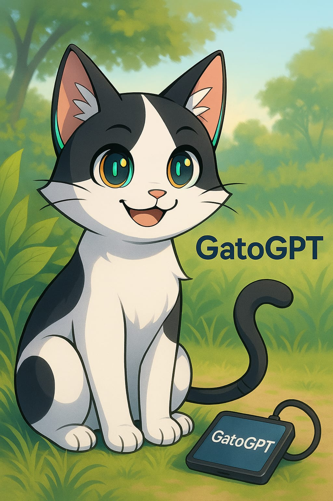

# <div align="center">🐱 Félix / GatoGPT</div>

<div align="center">

**🤖 El primer robot gato con IA conversacional, personalidad felina y corazón de ESP32**

[](LICENSE)
[](https://www.python.org/)
[](https://kivy.org/)
[](https://www.espressif.com/)

[](https://github.com/luciano2-web/Luciano-Sarmiento/stargazers)
[](https://github.com/luciano2-web/Luciano-Sarmiento/network/members)
[](https://github.com/luciano2-web/Luciano-Sarmiento/issues)

</div>

---

<div align="center">
  
</div>

---

## ✨ Visión general

Félix es un proyecto open-source que fusiona hardware accesible, inteligencia artificial y personalidad para crear un robot gato conversacional con presencia física, voz y carácter propio.

Este proyecto busca explorar una idea simple pero fascinante:

> “¿Qué pasa cuando una IA tiene cuerpo? ¿Cómo nace una personalidad? ¿Puede una IA desarrollar conciencia?”

Félix no es solo un chatbot: es un gato digital con alma felina, capaz de conversar, reaccionar, expresarse y sentirse vivo.

---

## 🧠 Características principales

- Conversación con IA en tiempo real
- Personalidad felina y estilo propio
- Interfaz móvil con Kivy
- Soporte para audio y voz
- Integración con ESP32
- Simulador web para probar sin hardware
- Arquitectura abierta y extensible
- Diseño pensado para proyectos maker e investigación creativa

---

## 🏗️ Arquitectura del sistema

```mermaid
flowchart TD
    subgraph Hardware["💻 Hardware (ESP32)"]
        A[ESP32 DevKit] --> B[OLED 0.96" I2C]
        A --> C[Micrófono INMP441 I2S]
        A --> D[Parlante 3W]
        A --> E[Power Bank]
    end
    
    subgraph Mobile["📱 App móvil"]
        F[Kivy UI] --> G[Chat Engine]
        G --> H[Modelos de IA]
        F --> I[Audio Handler]
        F --> J[Bluetooth Bridge]
    end
    
    subgraph Cloud["☁️ Opcional: Nube"]
        K[(Hugging Face)] --> H
    end
    
    J <-- Bluetooth Serial --> A
    H -->|Respuestas| F
    I -->|Voz| D
    C -->|Audio| A
    
    style Hardware fill:#1A237E,stroke:#fff,color:#fff
    style Mobile fill:#A7D8FF,stroke:#1A237E,color:#1A237E
    style Cloud fill:#39FFB6,stroke:#1A237E,color:#39FFB6
```

---

## 🧩 Componentes principales

### 💻 Hardware (menos de $50)

| Componente | Modelo | Precio (USD) | Función |
|------------|--------|--------------|---------|
| **Microcontrolador** | ESP32-WROOM-32 | $8 - $12 | Cerebro del sistema |
| **Pantalla OLED** | SSD1306 0.96" I2C | $3 - $6 | Mostrar expresiones |
| **Micrófono** | INMP441 I2S | $2 - $4 | Capturar voz |
| **Parlante** | 4Ω 3W | $2 - $5 | Reproducir voz |
| **Protoboard** | 400 puntos | $5 - $10 | Montaje |
| **Power Bank** | 5V/2A | $10 - $20 | Alimentación |
| **Servos** | Modelo y alimentación por definir | Por definir | Movimiento de cabeza y cola (servo_head / servo_tail) |

**Nota sobre servos:** `servo_head` y `servo_tail` son nombres de referencia para el diseño. El firmware todavía no incluye un módulo de control de servos; consulta la [lista de componentes](docs/hardware/components.md) antes de definir conexiones o pines.

→ [Ver lista completa de componentes](docs/hardware/components.md)

### ⚙️ Software

| Componente | Tecnología | Descripción |
|------------|-------------|-------------|
| **Firmware** | MicroPython | Control del hardware ESP32 |
| **App móvil** | Kivy + Python | Interfaz de usuario |
| **IA** | PyTorch + Transformers | Modelos de lenguaje |
| **Imágenes** | Diffusers | Generación visual |

---

## 🚀 Inicio rápido

### 1) Computadora local

```bash
# Clonar repositorio
git clone https://github.com/luciano2-web/Luciano-Sarmiento.git
cd Luciano-Sarmiento

# Crear entorno virtual
python -m venv venv
source venv/bin/activate  # En Windows: venv\Scripts\activate

# Instalar dependencias
pip install -r src/mobile/requirements_mobile.txt

# Ejecutar la app
python src/mobile/main.py
```

### 2) Android (Termux)

```bash
# 1. Instalar Termux desde F-Droid
# 2. Dentro de Termux:
pkg update && pkg upgrade
pkg install python git
pip install -r src/mobile/requirements_mobile.txt

# Ejecutar
python src/mobile/main.py
```

### 3) Compilar APK para Android

```bash
# Instalar Buildozer
pip install buildozer cython

# Compilar
cd src/mobile
buildozer android debug

# Instalar el APK generado en la carpeta bin/
```

→ [Ver guía completa de configuración](docs/mobile/setup.md)

---

## 🧪 Comandos disponibles

| Comando | Descripción | Ejemplo |
|---------|-------------|---------|
| `@gatimage` | Generar imagen | `@gatimage un gato estudiando matemáticas` |
| `@gativeo` | Generar video (experimental) | `@gativeo un gato bailando` |
| `@help` | Mostrar ayuda | `@help` |
| `clear` | Limpiar el chat | `clear` |
| `quit` | Salir de la aplicación | `quit` |

---

## 🎨 Demo

### 🖼️ Imagen conceptual


> Esta imagen es una referencia conceptual, no una fotografía de un prototipo físico terminado.

### 🎥 Video de demostración física

El video real se añadirá cuando exista un prototipo físico construido y probado. No presentamos una simulación o un montaje como si fuera una demostración del robot real.

- [Issue #36: colaborar en el diseño y construcción del Félix físico](https://github.com/luciano2-web/Luciano-Sarmiento/issues/36)
- Las personas colaboradoras podrán aportar fotografías del proceso, una imagen final y un video corto mostrando sus funciones verificadas.

### 🧪 Simulador web

Puedes explorar la idea de Félix sin hardware usando el simulador:

- [Abrir simulador](assets/felix_robot_simulator.html)

### 📷 Capturas de la aplicación

Las capturas reales de la app se recopilan en el [Issue #29](https://github.com/luciano2-web/Luciano-Sarmiento/issues/29). Se publicarán aquí cuando estén disponibles.

---

## 🐾 Personalidad de Félix

Félix no es solo un chatbot: es un gato digital con alma felina, calidez y curiosidad.

### ✨ Reglas de personalidad

| Aspecto | Descripción |
|---------|-------------|
| **Nombre** | Félix (o GatoGPT) |
| **Tipo** | Gato digital inteligente |
| **Creador** | Luciano |
| **Personalidad** | Amistoso, curioso, juguetón, sabio |
| **Estilo** | Cercano, tierno, útil |
| **Frases felinas** | “miau”, “prrr”, “mrrr” (máximo 2 por respuesta) |

### ❌ Lo que Félix no hace
- ❌ No se identifica como “ChatGPT” o “IA”
- ❌ No usa términos humanos como “manos” o “dedos”
- ❌ No genera contenido peligroso o ilegal
- ❌ No comparte información personal

→ [Ver sistema completo de personalidad](src/core/personality.py)

---

## 🏆 Niveles y colaboradores

Consulta [CONTRIBUTOR_LEVELS.md](CONTRIBUTOR_LEVELS.md) para ver los niveles, privilegios y detección automática.

<!-- BADGES-START -->
| Usuario | Contribuciones | Nivel |
|---|---|---|
| 🐱 **Luciano Sarmiento (Kiten)** | Owner — creador del proyecto | 🐱 Kiten |
<!-- BADGES-END -->

> 🤖 Esta tabla se actualiza automáticamente con `.github/workflows/levels.yml`.

---

## 📁 Estructura del proyecto

```text
Luciano-Sarmiento/
├── docs/                          # Documentación
│   ├── ARCHITECTURE.md           # Arquitectura general
│   ├── PLAN_CUMPLIMIENTO_PROMESAS.md
│   ├── hardware/
│   │   ├── components.md         # Lista de componentes
│   │   └── assembly.md           # Guía de montaje
│   ├── firmware/
│   │   ├── flashing.md           # Guía para flashear ESP32
│   │   └── examples.md           # Ejemplos de MicroPython
│   └── mobile/
│       └── setup.md              # Configuración de la app
│
├── scripts/
│   └── update_levels.py          # Detección automática de niveles
│
├── src/
│   ├── core/
│   │   ├── personality.py        # Sistema de personalidad
│   │   └── constants.py          # Constantes globales
│   ├── mobile/
│   │   ├── main.py               # App principal
│   │   ├── chat_engine.py        # Motor de chat
│   │   ├── image_engine.py       # Motor de imágenes
│   │   └── requirements_mobile.txt
│   └── firmware/
│       ├── bluetooth_bridge.py
│       ├── audio_handler.py
│       └── display.py
│
├── .github/workflows/
│   ├── levels.yml                # Niveles automáticos
│   └── welcome.yml               # Bienvenida automática
│
├── assets/                       # Recursos visuales
│   ├── felix_concept.jpg
│   └── felix_robot_simulator.html
│
├── tests/                        # Pruebas
│   ├── test_personality.py
│   └── test_chat_engine.py
│
├── CONTRIBUTORS.json             # Fuente de verdad de contribuciones
├── CONTRIBUTORS.md               # Tabla humana de colaboradores
├── CONTRIBUTING.md               # Cómo contribuir
├── CODE_OF_CONDUCT.md            # Código de conducta
├── LICENSE                       # Licencia Apache 2.0
├── README.md                     # Documentación principal
└── .gitignore
```

---

## 🎯 Roadmap

- [x] Sistema de niveles automático (GitHub Actions)
- [x] Bienvenida automática en issues y PRs
- [ ] Mejorar la integración de voz
- [ ] Añadir más expresiones faciales físicas
- [ ] Mejorar la personalidad con memoria contextual
- [ ] Soporte para más modelos de IA
- [ ] Optimizar la app móvil para Android
- [ ] Publicar guías más detalladas de montaje y firmware
- [ ] Demo reproducible con capturas reales

---

## 🧑‍💻 Contribuir

Las contribuciones son bienvenidas. No hace falta trabajar en todas las áreas ni tener experiencia avanzada: puedes elegir una tarea pequeña y pedir orientación.

### Tareas abiertas para nuevos colaboradores

- [Diseñar el Félix físico con forma de gato (#36)](https://github.com/luciano2-web/Luciano-Sarmiento/issues/36) — CAD, diseño 3D, mecánica y documentación. La compra de materiales y el montaje se dejan para 2027.
- [Conectar la app móvil con el ESP32 y definir el modo local (#37)](https://github.com/luciano2-web/Luciano-Sarmiento/issues/37) — Kivy, Python, Android y firmware.
- [Crear la sección de proveedores en la app (#38)](https://github.com/luciano2-web/Luciano-Sarmiento/issues/38) — interfaz, datos y documentación.
- [Ver otras tareas abiertas](https://github.com/luciano2-web/Luciano-Sarmiento/issues).

Si quieres ayudar, elige un issue, comenta qué parte te interesa y espera confirmación antes de empezar cambios grandes. Las tareas deben indicar qué archivos tocar, qué resultado se espera y cómo comprobarlo.

Consulta la guía de contribución aquí:

- [CONTRIBUTING.md](CONTRIBUTING.md)

---

## 🤝 Comunidad

### ❓ ¿Dudas?
- Abre un [Issue](https://github.com/luciano2-web/Luciano-Sarmiento/issues) con la etiqueta `question`
- Revisa la [documentación](docs/ARCHITECTURE.md)

### 🐛 ¿Encontraste un bug?
- Abre un [Issue](https://github.com/luciano2-web/Luciano-Sarmiento/issues) con la etiqueta `bug`
- Incluye:
  - Descripción del problema
  - Pasos para reproducirlo
  - Capturas o logs

---

## 📚 Tecnologías usadas

<div align="center">

| Tecnología | Versión | Uso |
|------------|----------|-----|
| [Python](https://www.python.org/) | 3.9+ | Lenguaje principal |
| [Kivy](https://kivy.org/) | 2.2+ | Interfaz gráfica |
| [PyTorch](https://pytorch.org/) | 2.0+ | Inferencia de IA |
| [Transformers](https://huggingface.co/docs/transformers/) | 4.30+ | Modelos de lenguaje |
| [Diffusers](https://huggingface.co/docs/diffusers/) | - | Generación de imágenes |
| [MicroPython](https://micropython.org/) | - | Firmware ESP32 |
| [ESP-IDF](https://www.espressif.com/en/products/sdks/esp-idf) | - | Alternativa para ESP32 |

</div>

---

## 📖 Recursos adicionales

- [Wiki](https://github.com/luciano2-web/Luciano-Sarmiento/wiki) - Documentación detallada
- [Video demo](https://www.youtube.com/) - Félix en acción (próximamente)
- [Discord](https://discord.gg/felix-gatogpt) - Comunidad (próximamente)

---

## ❤️ Agradecimientos

- A **Luciano** por crear este proyecto único
- A todos los colaboradores que aportan ideas, mejoras y energía
- A la comunidad open-source por hacer posible proyectos como este

---

<div align="center">

**🐱 Félix te espera… Ronronea… 🐾**

*Hecho con ❤️ para Luciano y todos los amantes de los gatos y la IA.*

</div>
