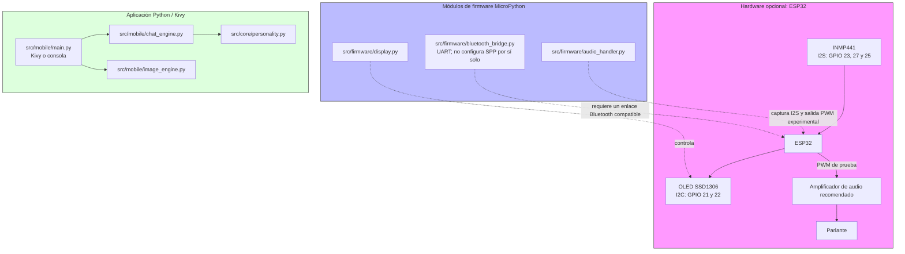
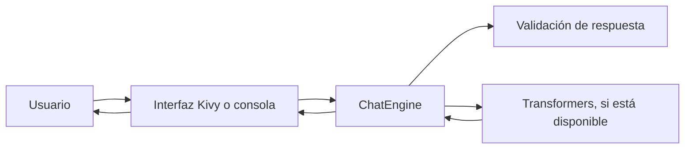
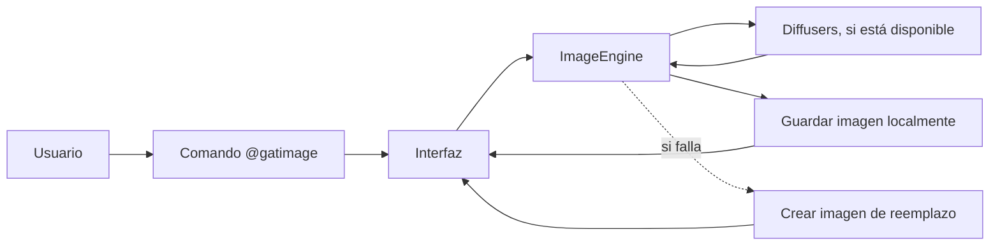

# 🎓 Arquitectura del Sistema — Félix / GatoGPT

**🐱 Versión: 2.0** | **Última actualización: 2024-09-28**

Este documento describe la arquitectura que existe en el repositorio: sus componentes, responsabilidades, conexiones de hardware y estructura de archivos. Las funciones indicadas como experimentales o pendientes no deben interpretarse como funciones ya integradas.

---

## 🌍 Tabla de Contenidos
1. [Visión General](#-visión-general)
2. [Diagrama de Arquitectura](#-diagrama-de-arquitectura)
3. [Componentes Principales](#-componentes-principales)
4. [Flujo de Datos](#-flujo-de-datos)
5. [Comunicación entre Componentes](#-comunicación-entre-componentes)
6. [Estructura del Código](#-estructura-del-código)
7. [Sistema de Personalidad](#-sistema-de-personalidad)
8. [Limitaciones y Consideraciones](#-limitaciones-y-consideraciones)

---

## 👀 Visión General

Félix / GatoGPT reúne código para tres áreas principales:

- **Hardware**: ejemplos y módulos para ESP32, pantalla OLED SSD1306, micrófono INMP441 y salida PWM de prueba.
- **Firmware**: módulos MicroPython para pantalla, audio y un puente de mensajes basado en UART. En el repositorio no hay un `src/firmware/main.py` que integre estos módulos ni un módulo de control de servos.
- **Aplicación de escritorio/móvil**: una interfaz Kivy con modo de consola, un motor de chat y otro de generación de imágenes. El código de la app no incluye actualmente un puente Bluetooth ni un manejador de audio.
- **IA**: el motor de chat usa Transformers cuando están disponibles; el motor de imágenes usa Diffusers. El uso de modelos depende de las dependencias, los recursos del dispositivo y la disponibilidad de los modelos.

La comunicación de extremo a extremo entre la app y el ESP32 no está implementada como una integración funcional en el estado actual del repositorio.

---

## 🎨 Diagrama de Arquitectura



---

## 💀 Componentes Principales

### 1. Capa de Hardware

| Componente | Modelo | Función | Conexión indicada en el proyecto |
|------------|--------|---------|----------------------------------|
| Microcontrolador | ESP32-WROOM-32 | Control del hardware | — |
| Pantalla | OLED SSD1306, 128×64 | Mostrar texto, emociones y gráficos | I2C: SCL GPIO 21, SDA GPIO 22 |
| Micrófono | INMP441 | Captura de audio digital | I2S: WS GPIO 23, BCK/SCK GPIO 27, SD GPIO 25 |
| Salida de audio | PWM de prueba | Señal de audio experimental | GPIO 26; usar amplificador adecuado |
| Alimentación | USB de 5 V | Alimentar la placa ESP32 | USB de la placa |
| Servos previstos | Modelo por definir | Movimiento de cabeza (`servo_head`) y cola (`servo_tail`) | Pendiente de diseño; sin pines ni alimentación definidos |

**Advertencia:** no conectes directamente un parlante de 4 Ω y 3 W a un GPIO del ESP32. Usa un amplificador de audio adecuado y sigue las especificaciones de la placa y del amplificador.

### 2. Capa de Firmware (MicroPython)

Módulos existentes en `src/firmware/`:

- `audio_handler.py`: inicialización de I2S para captura mono y salida PWM experimental; incluye grabación y tonos de prueba.
- `bluetooth_bridge.py`: serializa mensajes JSON delimitados por salto de línea y los envía/recibe mediante UART. **UART no proporciona por sí solo Bluetooth SPP**; para una conexión inalámbrica se necesita un periférico o módulo Bluetooth compatible y su configuración correspondiente.
- `display.py`: inicializa y controla una pantalla OLED SSD1306 por I2C.\n- `touch_sensor.py`: lee el TouchPad capacitivo del ESP32 clásico (GPIO 32 por defecto) y emite eventos de toque corto y pulsación larga. Aún debe ser llamado desde un bucle principal; no está integrado automáticamente.

No existe todavía un módulo `servos.py` ni código que inicialice o controle `servo_head` y `servo_tail`. Los nombres quedan establecidos como referencias de documentación; la selección de servos, alimentación, controlador, pines y pruebas debe definirse antes de implementar el control.

No existe actualmente un archivo `src/firmware/main.py` ni un punto de entrada que inicialice y coordine estos módulos. Tampoco hay un módulo de cámara: la visión queda pendiente de elegir una placa con memoria y conexión compatibles, y de implementar la captura.

### 3. Capa de Aplicación (Python y Kivy)

- `src/mobile/main.py`: interfaz Kivy y alternativa de consola; gestiona el chat y el comando `@gatimage`.
- `src/mobile/chat_engine.py`: generación de respuestas con un modelo de Transformers o respuestas de respaldo.
- `src/mobile/image_engine.py`: generación de imágenes con Diffusers y creación de una imagen de reemplazo si no se puede cargar el modelo.
- `src/mobile/gatogpt_felix_mobile.py`: módulo de la aplicación móvil.

La app actual no incluye módulos de captura/reproducción de audio ni un puente Bluetooth. La interfaz puede ejecutarse en una computadora si las dependencias de escritorio están instaladas; que el código use Kivy no garantiza por sí solo compatibilidad con Android o iOS.

### 4. Capa de IA

Los identificadores predeterminados están definidos en `src/core/constants.py`:

| Tarea | Identificador predeterminado | Implementación en el repositorio |
|-------|-----------------------------|----------------------------------|
| Chat | `microsoft/phi-2` | `src/mobile/chat_engine.py`, mediante Transformers cuando están instalados |
| Chat ligero | `TinyLlama/TinyLlama-1.1B-Chat-v1.0` | Disponible como constante alternativa |
| Imágenes | `segmind/SSD-1B` | `src/mobile/image_engine.py`, mediante Diffusers |
| Video | No definido | `@gativeo` aparece como constante, pero no hay un motor de video implementado |

La carga y ejecución local de modelos requiere instalar dependencias compatibles y contar con memoria, almacenamiento y capacidad de cómputo suficientes. No se garantiza que todos los modelos funcionen en un teléfono.

---

## 🐁 Flujo de Datos

### Chat de texto disponible



Si el modelo no se puede cargar, `ChatEngine` devuelve una respuesta de respaldo. La interfaz mantiene un historial de conversación en memoria durante la sesión.

### Generación de imágenes disponible



### Audio y ESP32

Los módulos de firmware ofrecen funciones de captura I2S, salida PWM experimental y control de OLED. No hay un flujo completo que conecte el firmware con la aplicación, ni reconocimiento de voz o síntesis de voz integrados de extremo a extremo.

---

## 🐈 Comunicación entre Componentes

### Mensajes del puente UART

`src/firmware/bluetooth_bridge.py` representa mensajes como JSON y usa `\n` como delimitador. El módulo envía estos bytes por UART; no implementa por sí mismo el descubrimiento, emparejamiento ni transporte Bluetooth.

Ejemplo del formato JSON que el código puede serializar:

```json
{
  "type": "response",
  "text": "¡Miau! Soy Félix, tu amigo felino.",
  "emotion": "happy"
}
```

El envío de audio binario no está definido como un protocolo interoperable en la app. Aunque el firmware contiene una función auxiliar para representar datos como hexadecimal, no constituye una integración de audio lista para usar.

### Comunicación interna de la app

La interfaz invoca los motores de chat e imágenes directamente. No hay un sistema Observer común ni una clase `BluetoothBridge` en `src/mobile/` en el árbol actual.

---

## 🐚 Estructura del Código

Árbol resumido de los archivos presentes en el repositorio:

```text
Luciano-Sarmiento/
├── .github/
│   ├── ISSUE_TEMPLATE/
│   ├── workflows/
│   └── PULL_REQUEST_TEMPLATE.md
├── assets/
│   ├── felix_concept.jpg
│   └── felix_robot_simulator.html
├── docs/
│   ├── ARCHITECTURE.md
│   ├── firmware/
│   │   ├── examples.md
│   │   └── flashing.md
│   ├── guides/
│   │   └── OPTIMIZACIÓN_VIDEO_COLAB.md
│   ├── hardware/
│   │   ├── assembly.md
│   │   └── components.md
│   └── mobile/
│       └── setup.md
├── src/
│   ├── core/
│   │   ├── __init__.py
│   │   ├── constants.py
│   │   └── personality.py
│   ├── firmware/
│   │   ├── __init__.py
│   │   ├── audio_handler.py
│   │   ├── bluetooth_bridge.py
│   │   └── display.py
│   ├── mobile/
│   │   ├── __init__.py
│   │   ├── buildozer.spec
│   │   ├── chat_engine.py
│   │   ├── felix_mobile_config.yaml
│   │   ├── gatogpt_felix_mobile.py
│   │   ├── image_engine.py
│   │   ├── main.py
│   │   └── requirements_mobile.txt
│   └── scripts/
│       ├── gatogpt_felix_colab.py
│       └── gatogpt_felix_luciano_colab.py
├── tests/
│   ├── __init__.py
│   ├── test_chat_engine.py
│   └── test_personality.py
├── gatogpt_felix_luciano_colab.py
├── gatogpt_felix_mobile.py
├── README.md
├── CONTRIBUTING.md
├── CODE_OF_CONDUCT.md
├── CONTRIBUTORS.md
├── CONTRIBUTOR_LEVELS.md
├── COLABORACION_STRATEGY.md
└── LICENSE
```

---

## 💋 Sistema de Personalidad

La personalidad y las reglas compartidas de Félix están definidas en `src/core/personality.py`, junto con constantes generales en `src/core/constants.py`.

El módulo de personalidad proporciona, entre otros elementos:

1. **`FELIX_SYSTEM_PROMPT`**: prompt del sistema para la experiencia general.
2. **`FELIX_SYSTEM_PROMPT_MOBILE`**: variante con respuestas más breves para móvil.
3. **`FELIX_PERSONALITY_RULES`**: reglas estructuradas de personalidad.
4. **`validate_felix_response()`**: validación de respuestas generadas.

El motor de chat móvil importa el prompt móvil y la función de validación para generar y revisar respuestas cuando sus dependencias están disponibles.

Ejemplo de importación:

```python
from src.core.personality import (
    FELIX_SYSTEM_PROMPT_MOBILE,
    validate_felix_response,
)

is_valid, issues, suggestions = validate_felix_response(
    "¡Miau! Estoy listo para ayudarte.",
    is_mobile=True,
)
```

---

## ⚠️ Limitaciones y Consideraciones

- **Pines ESP32:** GPIO 24 no está disponible en ESP32-WROOM-32. El reloj I2S configurado en las constantes del proyecto es GPIO 27. Comprueba el modelo de placa y el cableado antes de conectar los módulos.
- **Parlante:** la salida PWM es experimental y un GPIO no puede alimentar directamente un parlante de 4 Ω/3 W. Usa un amplificador apropiado.
- **Bluetooth:** UART cableado no equivale a Bluetooth SPP. Hace falta hardware y firmware Bluetooth compatibles; la app móvil tampoco incluye actualmente el puente correspondiente.
- **Firmware:** los módulos existen, incluido el lector de tacto, pero no hay un punto de entrada `src/firmware/main.py` que los integre.
- **Audio:** el reconocimiento y la síntesis de voz no están implementados como un flujo completo en la aplicación actual.
- **Cámara:** no está implementada. Para visión práctica se debe seleccionar y probar una placa/cámara concreta; el ESP32-WROOM-32 documentado no se debe tratar como una solución de cámara lista para conectar.\n- **Modelos:** la ejecución local de modelos pesados depende de las capacidades del dispositivo y de las dependencias instaladas.

---

[← Volver a la documentación](../README.md) | [Ver componentes de hardware →](hardware/components.md) | [Guía de ensamblaje →](hardware/assembly.md)
