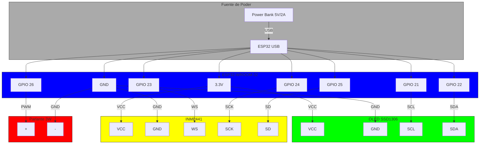

# 🐱 Guía de Ensamblaje de Félix

**🐾 Versión: 2.0** | **Última actualización: 2024-09-28**

Esta guía te llevará paso a paso a través del **ensamblaje del hardware** de Félix. Desde la conexión de los componentes hasta la prueba final.

---

## 🌍 Tabla de Contenidos
1. [Preparación](#-preparación)
2. [Paso 1: Conexión del ESP32](#1-paso-1-conexión-del-esp32)
3. [Paso 2: Conexión de la Pantalla OLED](#2-paso-2-conexión-de-la-pantalla-oled)
4. [Paso 3: Conexión del Micrófono INMP441](#3-paso-3-conexión-del-micrófono-inmp441)
5. [Paso 4: Conexión del Parlante](#4-paso-4-conexión-del-parlante)
6. [Paso 5: Conexión de la Fuente de Poder](#5-paso-5-conexión-de-la-fuente-de-poder)
7. [Paso 6: Prueba de Conexiones](#6-paso-6-prueba-de-conexiones)
8. [Paso 7: Carga del Firmware](#7-paso-7-carga-del-firmware)
9. [Paso 8: Prueba Final](#8-paso-8-prueba-final)
10. [Solución de Problemas](#-solución-de-problemas)
11. [Diagrama de Conexión Visual](#-diagrama-de-conexión-visual)

---

## 👨 Preparación

### 📍 Materiales Necesarios
Asegúrate de tener todos los componentes de la **[lista de componentes](components.md)**:
- ✅ ESP32-WROOM-32
- ✅ Pantalla OLED SSD1306 0.96"
- ✅ Micrófono INMP441
- ✅ Parlante 4Ω 3W
- ✅ Protoboard de 400+ puntos
- ✅ Cables jumper (Macho-Hembra)
- ✅ Power Bank 5V/2A
- ⏳ Servos para cabeza y cola (`servo_head` / `servo_tail`): previstos, pero modelo, cantidad física, alimentación y conexiones pendientes de definir. Esta es la convención estándar del proyecto para la nomenclatura de los servos.

### 🦾 Servos: estado de integración

Los servos forman parte de los componentes previstos, pero todavía no existe un módulo de firmware para controlarlos ni un esquema eléctrico aprobado. No añadas conexiones a pines concretos ni alimentes los servos desde el ESP32 hasta que se documenten el modelo, el consumo, la alimentación y el controlador adecuados. El colaborador puede implementar y probar esta parte cuando esas especificaciones estén confirmadas.

### 🐾 Herramientas Necesarias
- ✅ Pinzas para cortar/pelar cables
- ✅ Multímetro (opcional, pero recomendado)
- ✅ Computadora con **Arduino IDE** o **Thonny** (para cargar el firmware)
- ✅ Cable USB para conectar el ESP32 a la computadora

### ⚡ Recomendaciones
- Trabaja en una **superficie limpia y bien iluminada**.
- **No toques los componentes electrónicos** con las manos húmedas (pueden dañarse por electricidad estática).
- Usa **pulsera antiestática** si es posible.
- **Verifica las conexiones** dos veces antes de encender el sistema.

---

## ☁️ Paso 1: Conexión del ESP32

### 1.1 Coloca el ESP32 en el Protoboard
1. Inserta el **ESP32-WROOM-32** en el protoboard.
   - Asegúrate de que los pines estén bien alineados con los agujeros del protoboard.
   - **⚠️ No fuerces el ESP32** al insertarlo. Si no entra fácilmente, verifica la alineación.

```text
Protoboard:
+-------------------------------------+
|   |   |   |   |   |   |   |   |   |
|---+---+---+---+---+---+---+---+---|
|   |   |   |   |   |   |   |   |   |
+---+---+---+---+---+---+---+---+---+
|   |   |   |   |   |   |   |   |   |
|---+---+---+---+---+---+---+---+---|
|   |   |   | ESP32 |   |   |   |   |   |  <-- Insertar aquí
|---+---+---+---+---+---+---+---+---|
+-------------------------------------+
```

### 1.2 Identifica los Pines del ESP32
Usarás los siguientes pines para los componentes:

| Componente | Pin ESP32 | Tipo | Función |
|------------|-----------|------|---------|
| OLED SCL | GPIO 21 | Salida | I2C Clock |
| OLED SDA | GPIO 22 | Salida/Entrada | I2C Data |
| INMP441 WS | GPIO 23 | Salida | I2S Word Select |
| INMP441 SCK | GPIO 24 | Salida | I2S Clock |
| INMP441 SD | GPIO 25 | Entrada | I2S Data |
| Parlante | GPIO 26 | Salida | PWM |

---

## ☁️ Paso 2: Conexión de la Pantalla OLED

### 2.1 Conecta la OLED al Protoboard
1. Inserta la **pantalla OLED SSD1306** en el protoboard.
   - La OLED tiene **4 pines**: VCC, GND, SCL, SDA.

2. Conecta los pines de la OLED al ESP32:
   | OLED | ESP32 |
   |------|--------|
   | VCC | 3.3V |
   | GND | GND |
   | SCL | GPIO 21 |
   | SDA | GPIO 22 |

```text
OLED:
    +-----+
    | VCC |---> 3.3V (ESP32)
    | GND |---> GND (ESP32)
    | SCL |---> GPIO 21 (ESP32)
    | SDA |---> GPIO 22 (ESP32)
    +-----+
```

### 2.2 Verifica la Conexión
- Usa el **multímetro** para verificar que no haya cortocircuitos entre VCC y GND.
- Asegúrate de que los cables estén **bien conectados** (puedes tirar suavemente de ellos para verificar).

---

## ☁️ Paso 3: Conexión del Micrófono INMP441

### 3.1 Conecta el INMP441 al Protoboard
1. Inserta el **micrófono INMP441** en el protoboard.
   - El INMP441 tiene **5 pines**: VCC, GND, WS, SCK, SD.

2. Conecta los pines del INMP441 al ESP32:
   | INMP441 | ESP32 |
   |---------|--------|
   | VCC | 3.3V |
   | GND | GND |
   | WS | GPIO 23 |
   | SCK | GPIO 24 |
   | SD | GPIO 25 |

```text
INMP441:
    +---------+
    | VCC     |---> 3.3V (ESP32)
    | GND     |---> GND (ESP32)
    | WS      |---> GPIO 23 (ESP32)
    | SCK     |---> GPIO 24 (ESP32)
    | SD      |---> GPIO 25 (ESP32)
    +---------+
```

### 3.2 Notas Importantes
- El INMP441 **requiere 3.3V** (no 5V).
- Asegúrate de que los cables estén **bien aislados** para evitar interferencias.

---

## ☁️ Paso 4: Conexión del Parlante

### 4.1 Conecta el Parlante al Protoboard
1. Conecta el **parlante 4Ω 3W** al protoboard:
   - El parlante tiene **2 cables**: positivo (+) y negativo (-).

2. Conecta los cables del parlante al ESP32:
   | Parlante | ESP32 |
   |----------|--------|
   | + | GPIO 26 |
   | - | GND |

```text
Parlante:
    +--------+
    | +      |---> GPIO 26 (ESP32)
    | -      |---> GND (ESP32)
    +--------+
```

### 4.2 Notas Importantes
- El ESP32 puede **no tener suficiente potencia** para el parlante de 3W. Si el sonido es débil, considera usar un **amplificador de audio** (como el PAM8403).
- Si usas un amplificador, conecta el parlante al amplificador y el amplificador al ESP32.

---

## ☁️ Paso 5: Conexión de la Fuente de Poder

### 5.1 Conecta el Power Bank
1. Conecta el **Power Bank** al ESP32:
   - Usa un **cable USB** para conectar el Power Bank al puerto **USB del ESP32**.

```text
Power Bank:
    +---------+
    | USB     |---> ESP32 USB
    +---------+
```

### 5.2 Notas Importantes
- El Power Bank debe proporcionar **5V/2A** (mínimo).
- **No uses una fuente de poder que proporcione más de 5V** (puede dañar el ESP32).
- Si el Power Bank tiene un **interruptor**, enciéndelo.

---

## ☁️ Paso 6: Prueba de Conexiones

### 6.1 Verifica Visualmente
- Revisa que **todos los cables estén bien conectados**.
- Asegúrate de que **no haya cables sueltos** que puedan causar cortocircuitos.

### 6.2 Prueba con Multímetro
1. Configura el multímetro en modo **continuidad** (o resistencia).
2. Verifica que:
   - No haya continuidad entre **VCC y GND** (debe mostrar **OL** o resistencia infinita).
   - No haya continuidad entre **cualquier pin de datos y GND** (debe mostrar **OL**).

### 6.3 Prueba de Encendido
1. Conecta el **Power Bank al ESP32**.
2. El **LED rojo** del ESP32 debe encenderse (indica que está recibiendo poder).
3. Si el LED **no enciende**:
   - Verifica la conexión del Power Bank.
   - Prueba con otro cable USB.
   - Prueba con otra fuente de poder (ej: puerto USB de una computadora).

---

## ☁️ Paso 7: Carga del Firmware

### 7.1 Instala las Herramientas Necesarias
1. **Arduino IDE**: Descárgala de [arduino.cc](https://www.arduino.cc).
   - Instala el soporte para ESP32:
     - Ve a **File > Preferences**.
     - En **Additional Boards Manager URLs**, agrega:
       ```
       https://raw.githubusercontent.com/espressif/arduino-esp32/gh-pages/package_esp32_index.json
       ```
     - Ve a **Tools > Board > Boards Manager**, busca **esp32** e instala.

2. **Thonny** (alternativa para MicroPython):
   - Descárgala de [thonny.org](https://thonny.org).
   - Instala el plugin para ESP32.

### 7.2 Carga el Firmware
1. Conecta el **ESP32 a tu computadora** usando un cable USB.
2. Abre el **Arduino IDE** o **Thonny**.
3. Selecciona el **ESP32 Dev Module** como board:
   - En Arduino IDE: **Tools > Board > ESP32 Arduino > ESP32 Dev Module**.
   - En Thonny: **Run > Select interpreter > MicroPython (ESP32)**.

4. Selecciona el **puerto COM** correcto:
   - En Arduino IDE: **Tools > Port > COMX** (donde X es el número de puerto).
   - En Thonny: **Run > Select port > COMX**.

5. Abre el archivo de firmware (`src/firmware/main.py`) y cárgalo al ESP32.

---

## ☁️ Paso 8: Prueba Final

### 8.1 Prueba la OLED
1. El firmware debe **inicializar la OLED** y mostrar un mensaje de bienvenida.
2. Si la OLED **no muestra nada**:
   - Verifica las conexiones **I2C** (SCL y SDA).
   - Asegúrate de que la OLED esté **bien conectada** al protoboard.
   - Prueba con otro **cable jumper**.

### 8.2 Prueba el Bluetooth
1. Usa tu **teléfono** para buscar dispositivos Bluetooth.
2. El ESP32 debe aparecer como **"Félix"** o **"ESP32"**.
3. Conéctate al ESP32 usando la app móvil de Félix.
4. Si el Bluetooth **no funciona**:
   - Verifica que el **firmware esté cargado correctamente**.
   - Reinicia el ESP32.

### 8.3 Prueba el Micrófono y Parlante
1. Habla cerca del **micrófono INMP441**.
2. La app móvil debe **recibir el audio** y convertirlo a texto.
3. Félix debe **responder** y el parlante debe reproducir su voz.
4. Si el audio **no funciona**:
   - Verifica las conexiones **I2S** (WS, SCK, SD).
   - Asegúrate de que el **micrófono esté bien conectado**.
   - Prueba con otro **micrófono**.

---

## ⚠️ Solución de Problemas

### 💥 La OLED no enciende
| Problema | Causa | Solución |
|----------|-------|----------|
| No hay imagen | Conexión I2C incorrecta | Verifica SCL (GPIO 21) y SDA (GPIO 22) |
| Pantalla en blanco | OLED defectuosa | Prueba con otra OLED |
| Pantalla con caracteres raros | Voltaje incorrecto | Usa 3.3V (no 5V) |

### 📡 Bluetooth no funciona
| Problema | Causa | Solución |
|----------|-------|----------|
| No aparece el ESP32 | Firmware no cargado | Recarga el firmware |
| Conexión falla | Distancia | Acércate el teléfono al ESP32 |
| Conexión se corta | Interferencias | Aleja otros dispositivos Bluetooth |

### 💰 Audio no funciona
| Problema | Causa | Solución |
|----------|-------|----------|
| No se graba audio | Conexión I2S incorrecta | Verifica WS, SCK, SD |
| Sonido distorsionado | Parlante de baja calidad | Prueba con otro parlante |
| Sonido muy bajo | Falta amplificador | Usa un amplificador PAM8403 |

---

## 🎨 Diagrama de Conexión Visual



---

## 👋 Consejos Finales

1. **Paciencia**: El ensamblaje puede tomar **1-2 horas** si es tu primera vez.
2. **Pruebas incrementales**: Conecta y prueba **un componente a la vez** (ej: primero la OLED, luego el micrófono).
3. **Documenta**: Toma **fotos** de tu montaje para referencia futura.
4. **Pide ayuda**: Si tienes problemas, abre un **Issue** en GitHub con la etiqueta `hardware`.

---

## 🐱 ¡Félix está listo!

Una vez que todo funcione, **Félix cobrará vida** y podrás:
- ✅ Chatear con él mediante voz o texto.
- ✅ Ver sus expresiones en la OLED.
- ✅ Escuchar sus respuestas en voz alta.
- ✅ Generar imágenes con `@gatimage`.

**⚡ Próximo paso:** [Configurar la App Móvil →](../mobile/setup.md)

---

**🐱 Félix te observa... Ronronea... 🐾**

[← Volver a Hardware](components.md) | [💂 Ver Firmware Guide →](../firmware/flashing.md)
