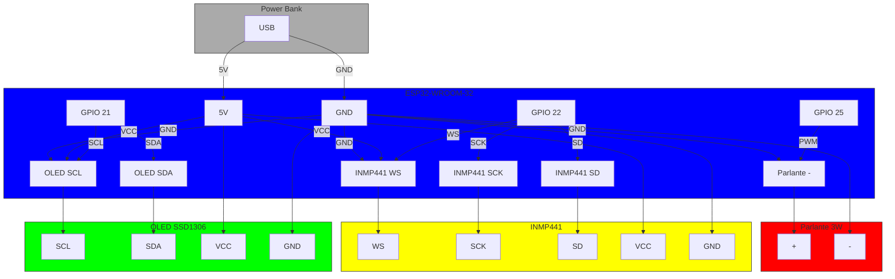

# 💻 Lista de Componentes de Hardware

**🐱 Félix v2.0** | **Última actualización: 2024-09-28**

Este documento detalla **todos los componentes de hardware** necesarios para construir a Félix, incluyendo alternativas, precios aproximados y enlaces de compra.

---

## 🌍 Tabla de Contenidos
1. [Lista de Componentes](#-lista-de-componentes)
2. [Diagrama de Conexiones](#-diagrama-de-conexiones)
3. [Alternativas y Recomendaciones](#-alternativas-y-recomendaciones)
4. [Dónde Comprar](#-dónde-comprar)
5. [Herramientas Necesarias](#-herramientas-necesarias)

---

## 📋 Lista de Componentes

### ✅ Componentes Básicos (Obligatorios)

| # | Componente | Modelo | Cantidad | Precio (USD) | Función | Protocolo |
|---|------------|--------|----------|--------------|---------|-----------|
| 1 | **Microcontrolador** | ESP32-WROOM-32 | 1 | $8 - $12 | Cerebro del sistema | - |
| 2 | **Pantalla OLED** | SSD1306 0.96" I2C | 1 | $3 - $6 | Mostrar expresiones de Félix | I2C |
| 3 | **Micrófono** | INMP441 I2S | 1 | $2 - $4 | Capturar voz del usuario | I2S |
| 4 | **Parlante** | 4Ω 3W | 1 | $2 - $5 | Reproducir voz de Félix | PWM |
| 5 | **Protoboard** | 400 puntos | 1 | $5 - $10 | Montaje de componentes | - |
| 6 | **Cables Jumper** | Macho-Hembra | 20 | $3 - $6 | Conexiones | - |
| 7 | **Fuente de Poder** | Power Bank 5V/2A | 1 | $10 - $20 | Alimentación | USB |
| 8 | **Servos** | Modelo por definir | Por definir | Por definir | Movimiento de cabeza y cola (`servo_head` / `servo_tail`) | Por definir |

**Total estimado (básico):** **$33 - $63 USD**

---

### ⚡ Componentes Opcionales (Mejoras)

| # | Componente | Modelo | Cantidad | Precio (USD) | Función | Protocolo |
|---|------------|--------|----------|--------------|---------|-----------|
| 8 | **Amplificador de Audio** | PAM8403 | 1 | $2 - $4 | Mejorar calidad de audio | - |
| 9 | **Batería LiPo** | 18650 3.7V | 1 | $8 - $15 | Alimentación portátil | - |
| 10 | **Módulo Bluetooth** | HC-05 | 1 | $5 - $8 | Alternativa a Bluetooth del ESP32 | UART |
| 11 | **Sensor de tacto** | TouchPad capacitivo integrado / electrodo táctil | 1 | Sin módulo externo si se usa el TouchPad integrado | Detectar caricias y pulsaciones | GPIO 32 (ESP32 clásico) |
| 12 | **LED RGB** | WS2812B | 1 | $1 - $2 | Indicador de estado | PWM |
| 13 | **Cámara (pendiente)** | Placa ESP32-S3 con PSRAM + cámara compatible (p. ej. OV2640 si la placa la admite) | 1 | Por definir | Capturar imágenes para visión | Interfaz de cámara de la placa |\n| 14 | **Carcasa 3D** | Impresión 3D | 1 | $10 - $30 | Cuerpo de Félix | - |

**Total estimado (con mejoras):** **$62 - $135 USD**, sin incluir cámara ni placa de visión (pendientes de selección).\n\n### 🐾 Sensor de tacto\n\nEl ESP32 clásico incluye entradas capacitivas TouchPad. El firmware de Félix reserva **GPIO 32** para un electrodo táctil; el módulo `src/firmware/touch_sensor.py` distingue un toque corto (`pet`) de una pulsación larga (`press_to_talk_start` / `press_to_talk_end`). La pulsación larga solo emite eventos: el audio y la app todavía deben integrarse para que hablar funcione de extremo a extremo. El sensor capacitivo detecta contacto, no mide la fuerza aplicada. Calibra sin tocar el electrodo y confirma el pin de tu placa antes de cablear.\n\n### 📷 Cámara y visión\n\nLa cámara **no está lista para conectar** al ESP32-WROOM-32 de la lista actual. Antes de escribir un controlador hay que elegir una placa concreta con memoria suficiente (recomendación a evaluar: ESP32-S3 con PSRAM y una cámara compatible, como OV2640 si la placa la soporta). El módulo de cámara debe tener un indicador visible y un control físico para apagarla; no se transmitirán imágenes sin autorización. La selección e integración están en el [Issue #39](https://github.com/luciano2-web/Luciano-Sarmiento/issues/39).

### 🦾 Servos y movimiento

Los servos se contemplan como componentes del proyecto para permitir el movimiento de la cabeza y la cola. Para mantener una nomenclatura coherente, se reservan estos identificadores:

- `servo_head`: servo destinado al movimiento de la cabeza.
- `servo_tail`: servo destinado al movimiento de la cola.

**Estado actual:** el repositorio todavía no contiene un módulo de firmware que controle servos. El modelo, cantidad física, alimentación, controlador, pines y límites de movimiento quedan pendientes de definir según los servos y el montaje que se seleccionen. No conectes servos ni asumas pines o voltajes hasta documentar y verificar esas especificaciones. Esta sección no representa una implementación funcional.

---

## 🎨 Diagrama de Conexiones

### Conexiones del ESP32

### Tabla de Pines del ESP32

| Componente | Pin ESP32 | Tipo | Notas |
|------------|-----------|------|-------|
| OLED SCL | GPIO 21 | Salida | I2C Clock |
| OLED SDA | GPIO 22 | Salida/Entrada | I2C Data |
| INMP441 WS | GPIO 23 | Salida | I2S Word Select |
| INMP441 SCK | GPIO 24 | Salida | I2S Clock |
| INMP441 SD | GPIO 25 | Entrada | I2S Data |
| Parlante | GPIO 26 | Salida | PWM |
| Tacto capacitivo | GPIO 32 | Entrada TouchPad | Electrodo; lectura capacitiva, no fuerza |\n| Bluetooth | - | - | Integrado en el chip; el transporte de la app aún no está implementado |

---

## 👨 Alternativas y Recomendaciones

### Microcontroladores
| Modelo | Pros | Contras | Precio | Compatibilidad |
|--------|------|---------|--------|----------------|
| **ESP32-WROOM-32** | WiFi + Bluetooth, popular, buena documentación | - | $8-$12 | ✅ Recomendado |
| ESP32-S3 | Más memoria, USB nativo | Menos soporte en librerías | $10-$15 | ✅ Bueno |
| ESP32-C3 | WiFi + Bluetooth 5.0 | Menos GPIO | $8-$12 | ✅ Bueno |
| Raspberry Pi Pico W | Más potente, MicroPython | No Bluetooth nativo | $10 | ❌ No recomendado |

**Recomendación actual para control básico:** ESP32-WROOM-32. **Para visión integrada**, evaluar una placa ESP32-S3 con PSRAM y conector/interfaz de cámara; no asumir que el WROOM-32 puede sustituirla sin rediseñar pines y memoria.

---

### Pantallas OLED
| Modelo | Tamaño | Resolución | Protocolo | Precio | Notas |
|--------|--------|------------|-----------|--------|-------|
| **SSD1306** | 0.96" | 128x64 | I2C | $3-$6 | ✅ Recomendado |
| SH1106 | 1.3" | 128x64 | I2C | $5-$8 | Más grande, mismo precio |
| SSD1309 | 1.3" | 128x64 | SPI/I2C | $7-$10 | Mejor contraste |

**Recomendación:** **SSD1306 0.96"** (el más común y económico).

---

### Micrófonos
| Modelo | Tipo | Protocolo | Sensibilidad | Precio | Notas |
|--------|------|-----------|--------------|--------|-------|
| **INMP441** | MEMS | I2S | Alta | $2-$4 | ✅ Recomendado |
| MAX44660 | Electret | Analógico | Media | $3-$5 | Requiere amplificador |
| MAX9814 | Electret | Analógico | Media | $2-$4 | Más simple |

**Recomendación:** **INMP441** (mejor calidad y compatibilidad con I2S).

---

### Parlantes
| Modelo | Impedancia | Potencia | Tamaño | Precio | Notas |
|--------|------------|----------|--------|--------|-------|
| **4Ω 3W** | 4Ω | 3W | 40mm | $2-$5 | ✅ Recomendado |
| 8Ω 0.5W | 8Ω | 0.5W | 30mm | $1-$3 | Menos potencia |
| 4Ω 5W | 4Ω | 5W | 50mm | $5-$8 | Más grande |

**Recomendación:** **4Ω 3W** (buen equilibrio entre tamaño y calidad).

---

## 📍 Dónde Comprar

### Tiendas Internacionales
| Tienda | Enlace | Notas |
|--------|--------|-------|
| **AliExpress** | [www.aliexpress.com](https://www.aliexpress.com) | Precios bajos, envío lento |
| **Amazon** | [www.amazon.com](https://www.amazon.com) | Envío rápido, precios variables |
| **LCSC** | [www.lcsc.com](https://www.lcsc.com) | Componentes electrónicos |
| **Digi-Key** | [www.digikey.com](https://www.digikey.com) | Amplio catálogo, envío rápido |
| **Mouser** | [www.mouser.com](https://www.mouser.com) | Componentes de calidad |
| **SparkFun** | [www.sparkfun.com](https://www.sparkfun.com) | Kits y tutoriales |
| **Adafruit** | [www.adafruit.com](https://www.adafruit.com) | Buen soporte y guías |

### Tiendas por País

#### 🇮🇨 Colombia
| Tienda | Enlace | Notas |
|--------|--------|-------|
| **Mercado Libre** | [www.mercadolibre.com.co](https://www.mercadolibre.com.co) | Envío local |
| **Linio** | [www.linio.com.co](https://www.linio.com.co) | Variedad de productos |
| **Electrónica RC** | [www.electronicarcto.com](https://www.electronicarcto.com) | Componentes electrónicos |

#### 🇪🇸 España
| Tienda | Enlace | Notas |
|--------|--------|-------|
| **Amazon España** | [www.amazon.es](https://www.amazon.es) | Envío rápido |
| **Electrónica Picasa** | [www.picasa-electronica.com](https://www.picasa-electronica.com) | Componentes para makers |

#### 🇲🇽 México
| Tienda | Enlace | Notas |
|--------|--------|-------|
| **Mercado Libre México** | [www.mercadolibre.com.mx](https://www.mercadolibre.com.mx) | Envío local |
| **Amazon México** | [www.amazon.com.mx](https://www.amazon.com.mx) | Envío rápido |

#### 🇦🇷 Argentina
| Tienda | Enlace | Notas |
|--------|--------|-------|
| **Mercado Libre Argentina** | [www.mercadolibre.com.ar](https://www.mercadolibre.com.ar) | Envío local |
| **Electrónica Venex** | [www.venex.com.ar](https://www.venex.com.ar) | Componentes electrónicos |

---

## 🐾 Herramientas Necesarias

### Herramientas Básicas
| Herramienta | Descripción | Precio (USD) | Opcional |
|-------------|-------------|--------------|----------|
| **Soldador** | 30W-60W | $10-$20 | ❌ No (se usa protoboard) |
| **Pasta para soldar** | - | $5 | ❌ No |
| **Cautín** | - | - | ✅ Sí (si se suelda) |
| **Multímetro** | Medir voltaje, corriente | $15-$50 | ✅ Sí |
| **Pinzas** | Cortar y pelar cables | $5-$10 | ✅ Sí |
| **Destornillador** | Ajustar tornillos | $5 | ✅ Sí |

### Software Necesario
| Software | Descripción | Enlace | Plataforma |
|----------|-------------|--------|------------|
| **Arduino IDE** | Programar ESP32 | [arduino.cc](https://www.arduino.cc) | Windows/macOS/Linux |
| **PlatformIO** | Alternativa a Arduino IDE | [platformio.org](https://platformio.org) | Windows/macOS/Linux |
| **Thonny** | IDE para MicroPython | [thonny.org](https://thonny.org) | Windows/macOS/Linux |
| **Python 3.9+** | Para la app móvil | [python.org](https://python.org) | Windows/macOS/Linux |
| **Buildozer** | Compilar app para Android | [buildozer.dev](https://buildozer.dev) | Windows/macOS/Linux |
| **Fritzing** | Diseñar diagramas | [fritzing.org](https://fritzing.org) | Windows/macOS/Linux |

---

## 👋 Guía de Compra Rápida

### Opción 1: Kit Básico (Mínimo)
| Componente | Modelo | Cantidad | Precio (USD) | Total |
|------------|--------|----------|--------------|-------|
| ESP32-WROOM-32 | - | 1 | $10 | $10 |
| OLED SSD1306 0.96" | - | 1 | $5 | $15 |
| INMP441 | - | 1 | $3 | $18 |
| Parlante 4Ω 3W | - | 1 | $3 | $21 |
| Protoboard 400 | - | 1 | $5 | $26 |
| Cables Jumper | - | 20 | $4 | $30 |
| Power Bank | - | 1 | $10 | **$40** |

**Total: ~$40 USD**

### Opción 2: Kit Recomendado (Con Mejoras)
| Componente | Modelo | Cantidad | Precio (USD) | Total |
|------------|--------|----------|--------------|-------|
| ESP32-WROOM-32 | - | 1 | $10 | $10 |
| OLED SH1106 1.3" | - | 1 | $7 | $17 |
| INMP441 | - | 1 | $3 | $20 |
| Parlante 4Ω 3W | - | 1 | $3 | $23 |
| Amplificador PAM8403 | - | 1 | $3 | $26 |
| Protoboard 800 | - | 1 | $8 | $34 |
| Cables Jumper | - | 30 | $6 | $40 |
| Power Bank | - | 1 | $15 | $55 |
| LED RGB WS2812B | - | 1 | $2 | **$57** |

**Total: ~$57 USD**

---

## 🐱 ¿Preguntas Frecuentes?

### ❓ ¿Puedo usar otros componentes?
**Sí**, pero asegúrate de que sean **compatibles** con el ESP32 y el firmware de Félix. Si usas alternativas, puede que necesites modificar el código.

### ❓ ¿Dónde puedo comprar los componentes en mi país?
Consulta la sección **[Dónde Comprar](#-dónde-comprar)** o busca en **Mercado Libre** o **Amazon** de tu país.

### ❓ ¿Necesito soldar?
**No**, el diseño actual usa **protoboard y cables jumper**, por lo que no es necesario soldar. Sin embargo, si quieres un montaje más permanente, puedes soldar los componentes.

### ❓ ¿Puedo usar una Raspberry Pi en lugar del ESP32?
**No recomendado**. El proyecto está optimizado para **ESP32** (bajo consumo, Bluetooth integrado). Si quieres usar una Raspberry Pi, tendrías que reescribir gran parte del firmware.

### ❓ ¿Puedo usar un micrófono analógico?
**Sí**, pero necesitarás un **convertidor ADC** (el ESP32 tiene ADC integrado, pero la calidad no será tan buena como con el INMP441 I2S).

---

## 📈 Recursos Adicionales

- [Hoja de datos del ESP32-WROOM-32](https://www.espressif.com/sites/default/files/documentation/esp32-wroom-32_datasheet_en.pdf)
- [Hoja de datos del SSD1306](https://cdn-shop.adafruit.com/datasheets/SSD1306.pdf)
- [Hoja de datos del INMP441](https://www.invensense.com/wp-content/uploads/2015/02/INMP441.pdf)
- [Guía de conexión I2C en ESP32](https://docs.espressif.com/projects/esp-idf/en/latest/esp32/api-reference/peripherals/i2c.html)
- [Guía de conexión I2S en ESP32](https://docs.espressif.com/projects/esp-idf/en/latest/esp32/api-reference/peripherals/i2s.html)

---

**🐱 Félix te espera... ¡Es hora de construirlo! 🐾**

[← Volver a Hardware](hardware) | [💂 Ver Assembly Guide →](assembly.md)
